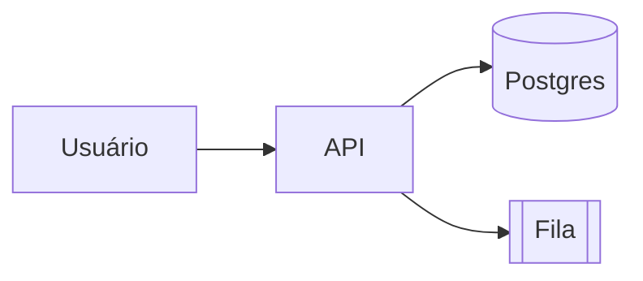

# TEMPLATES — Moldes para novos projetos e notas

> Copie o bloco que precisa, cole no arquivo novo, preencha os `<placeholders>`. Mantenha estes templates **enxutos** — quanto menos, melhor para tokens.

---

## 1. Iniciar um novo projeto

Crie a pasta `projetos/<nome-kebab-case>/` com os 4 arquivos abaixo + `notas/` + `snippets/`.

### `SPEC.md`

```markdown
# <Nome do Projeto> — SPEC

**Status**: 🟢 ativo · 🟡 em pausa · 🔴 arquivado · ⚪ planejado
**Repo**: <url-do-github-ou-"local">
**Owner**: Hachid
**Última revisão**: <YYYY-MM-DD>

## Problema
<Uma frase: que dor este projeto resolve?>

## Objetivo
<Uma frase mensurável: quando consideramos pronto?>

## Requisitos funcionais
- [ ] <RF-01: o sistema deve ...>
- [ ] <RF-02: ...>

## Requisitos não-funcionais
- Latência: <...>
- Custo: <...>
- Privacidade/LGPD: <...>

## Fora de escopo
- <O que explicitamente NÃO faremos nesta versão>

## Critérios de aceite
- <Lista do que o usuário/cliente verá funcionando>
```

### `CONTEXTO.md`

```markdown
# <Nome> — CONTEXTO

## Stack
- Linguagem: <Python 3.12 / Node 20 / Go 1.22 ...>
- Framework: <FastAPI / Express / ...>
- DB: <Postgres 16 / SQLite / ...>
- Infra: <Docker Compose local / Fly.io / VPS Hostinger ...>

## Ambientes
| Env | URL | Notas |
|---|---|---|
| local | http://localhost:<porta> | docker compose up |
| prod | <url> | <provedor, região> |

## Credenciais (refs, NUNCA o valor)
- `WHATSAPP_TOKEN` → 1Password://Vault/Item
- `OPENAI_API_KEY` → ~/.env

## Glossário do domínio
- **<termo>**: <definição>
- **<termo>**: <definição>

## Pessoas / Stakeholders
- <Nome — papel — contato>
```

### `ARQUITETURA.md`

```markdown
# <Nome> — ARQUITETURA

## Visão de alto nível
<Diagrama em Mermaid OU descrição em 5 linhas>



## Módulos
- **<modulo-a>**: <responsabilidade>
- **<modulo-b>**: <responsabilidade>

## Fluxos críticos
1. <Fluxo X passo a passo>
2. <Fluxo Y>

## Dependências externas
- <API/serviço> — <por que e o que falha se cair>

## Decisões importantes
Veja [[notas/decisoes]] para o histórico completo.
- ADR-001: <título> — <YYYY-MM-DD>
```

### `PROGRESSO.md`

```markdown
# <Nome> — PROGRESSO

> Log mais recente no topo. Cada sessão = uma entrada.

---

## <YYYY-MM-DD> — <título curto>
**Sessão**: <Claude Code / manual>
**Duração aprox**: <Xh>

### Feito
- <bullet curto>

### Decisões
- <decisão e por quê — link para ADR se aplicável>

### Bloqueios
- <o que está travando>

### Próximos passos
- [ ] <ação concreta>
- [ ] <ação concreta>

---

## Backlog (não datado)
- [ ] <ideia/feature que ainda não tem prazo>
```

---

## 2. Nota de Decisão (ADR-like)

Arquivo em `<projeto>/notas/decisoes/ADR-<NNN>-<slug>.md`

```markdown
# ADR-<NNN>: <Título da decisão>

**Data**: <YYYY-MM-DD>
**Status**: proposta · aceita · substituída · descartada

## Contexto
<O que motivou a decisão? Que restrições existiam?>

## Decisão
<O que foi escolhido. Em uma frase.>

## Alternativas consideradas
- **A**: <prós/contras>
- **B**: <prós/contras>

## Consequências
- ✅ <ganho>
- ⚠️ <custo / risco>

## Referências
- <links, issues, PRs>
```

---

## 3. Snippet de código

Arquivo em `<projeto>/snippets/<linguagem>-<slug>.md`

````markdown
# <Título do snippet>

**Quando usar**: <contexto em uma linha>
**Última verificação**: <YYYY-MM-DD>

```<linguagem>
<código>
```

**Notas**:
- <gotcha 1>
- <gotcha 2>
````

---

## 4. Nota de aprendizado

Arquivo em `aprendizado/<YYYY-MM-DD>-<slug>.md`

```markdown
# <Título>

**Fonte**: <livro / curso / vídeo / paper — link>
**Tempo gasto**: <Xh>
**Tags**: #<topico>

## Pontos-chave
- <bullet>

## Como aplico nos meus projetos
- <onde isso encaixa em [[projetos/...]]>
```
