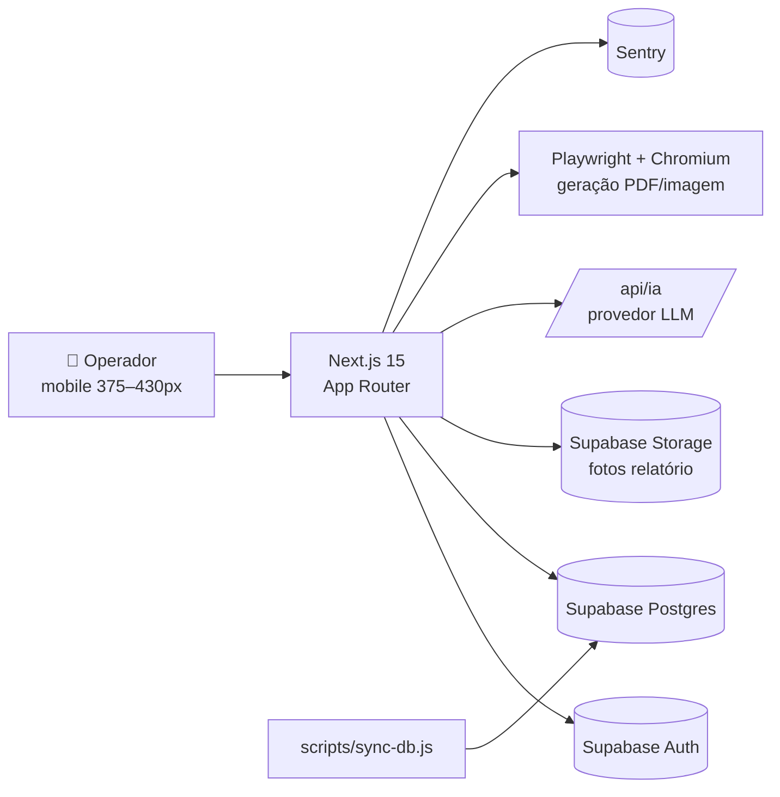

# Sistema GAEP — ARQUITETURA

## Visão de alto nível



## Módulos (App Router)

```
app/
├── (auth)/
│   └── login/page.tsx           # ETAPA 1
├── (app)/
│   ├── relatorio/page.tsx       # ETAPA 2 (default após login)
│   ├── dashboard/page.tsx       # ETAPA 3 — Painel BI
│   ├── operadores/page.tsx      # ETAPA 4 — Desempenho Individual
│   ├── missoes/page.tsx         # ETAPA 5
│   └── gestao/page.tsx          # ETAPA 6 — Admin / Super Admin
└── api/
    ├── ia/route.ts              # POST: gera texto a partir do form de relatório
    └── pdf/route.ts             # POST: render Playwright → PDF/PNG (folha-ponto, etc.)

lib/
└── supabase/
    ├── client.ts                # cliente browser
    └── server.ts                # cliente server-only (a criar se ainda não existir)

components/                      # a organizar por etapa, ex: relatorio/EquipeChips.tsx
```

## Dados — entidades principais (Supabase)

> Schema canônico: `handoff/sql/001_schema.sql`. Resumo abaixo.

- `operadores` — id, nome, matrícula, perfil, equipe_id, gaep_id, deleted_at
- `equipes`
- `gaeps` — multi-unidade, gerenciado por SUPER_ADMIN
- `categorias` (OPERAR, TREINAR, INSTRUIR…)
- `atividades` — pertencem a uma categoria
- `relatorios` — gaep_id, data, hora_inicio, hora_fim, horas_totais, categoria_id, atividade_id, relatorista_id, descricao_bruta, descricao_revisada, ocorrencias, fotos_urls
- `relatorio_participantes` — relatorio_id, operador_id, hora_inicio, hora_fim, horas_totais
- `missoes` — gaep_id, operador_id, qtd_diarias, tipo_missao, **valor_unitario_snapshot**, valor_total, observacao, data_missao, deleted_at
- `tipos_missao` + tabela de **vigências** de valor (histórico)
- `feriados`
- `config_ia` — modelo, temperatura, prompt do sistema

## Fluxos críticos

1. **Login (ETAPA 1)**: select de operador (lê `operadores.nome` do Supabase) + senha (default = matrícula). `signInWithPassword({ email: matricula@gaep.internal, password })`. Em sucesso, redireciona `/relatorio`.

2. **Registro de operação (ETAPA 2)**: form preenche `relatorios` + N linhas em `relatorio_participantes`. Caminho IA: `POST /api/ia` → modelo retorna texto formatado → user revisa → INSERT final. Fotos viajam para Supabase Storage (até 3); URLs ficam em `fotos_urls`.

3. **Painel BI (ETAPA 3)**: queries agregadas (server components ou route handlers), Recharts no client. Filtro `Trimestral | Semestral | Anual | Total`.

4. **FolhaPonto (ETAPA 4)**: query consolidada em `relatorio_participantes` + `relatorios` + `atividades`. Render de tabela com merge visual de datas e linha "TOTAL DO DIA". Exportável via `/api/pdf` (Playwright).

5. **Missões (ETAPA 5)**: ao salvar, lê valor vigente do `tipo_missao` e copia para `valor_unitario_snapshot`. Edições futuras de valor **não** retroagem.

6. **Gestão (ETAPA 6)**: tabs com guards de perfil (server-side). Editar usuário → modal → UPDATE. Desativar → `UPDATE ... SET deleted_at = now()`. Diárias: novas vigências geram nova linha datada.

## Dependências externas e modos de falha

- **Supabase** — sem ele, tudo cai. Mitigação: monitor de uptime + página de erro amigável + Sentry.
- **Provedor LLM** (`/api/ia`) — fallback: salvar `descricao_bruta` sem revisão e marcar para retry posterior.
- **Chromium / Playwright** (server) — usado em geração de PDF; em Vercel exige `@sparticuz/chromium` (já instalado). Verificar runtime `nodejs` (não `edge`) na rota.
- **Sentry** — não bloqueante; falha silenciosa se DSN ausente.

## Decisões importantes

Veja `notas/decisoes/` para o histórico completo. (Vazio no início — adicionar conforme decisões surgirem.)

- ADR-001 (a registrar): Auth por matrícula em Supabase via email sintético `@gaep.internal`.
- ADR-002 (a registrar): Geração de PDFs com Playwright + Chromium serverless.
- ADR-003 (a registrar): Snapshot de valor de diária (não-retroatividade).

## Pontos de atenção / Tech debt

- [ ] Sem `package.json` mostra script de migração formal — toda vida do schema vive em `scripts/sync-db.js`. Avaliar troca para `supabase migration new`.
- [ ] `cleanup-maio-2026.js` é destrutivo — adicionar guard que exige flag explícita (`--confirm`) e dump prévio.
- [ ] Sentry está em deps mas confirmar se está inicializado (`sentry.client.config.ts`, `sentry.server.config.ts`).
- [ ] Documentar route handlers de IA e PDF (entrada/saída JSON) numa nota dedicada.
- [ ] `next-config` não foi visto na listagem — confirmar se existe `next.config.{js,ts,mjs}`.
