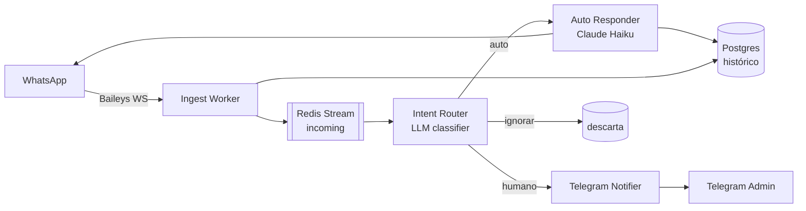

# WhatsApp Bot — ARQUITETURA

## Visão de alto nível

## Módulos

- **`ingest/`** — conecta ao WhatsApp via Baileys, normaliza eventos, publica no stream `incoming`. Mantém `auth_info_baileys/` no volume Docker.
- **`router/`** — consome `incoming`, faz uma chamada LLM rápida classificando em `auto | humano | ignorar`. Cacheia resultado por 5 min para o mesmo contato + intenção.
- **`responder/`** — para mensagens `auto`: busca últimas 30 msgs do contato no Postgres, monta prompt, chama Claude Haiku, envia resposta de volta via Baileys. Persiste a troca.
- **`notifier/`** — para `humano`: dispara mensagem no Telegram com preview e link `wa.me/<numero>`.
- **`admin/`** — bot Telegram que aceita `/pausar <numero>`, `/retomar <numero>`, `/status`. Estado guardado em Redis (set `paused_contacts`).

## Fluxos críticos

1. **Mensagem entrante (caminho feliz)**: WA → Baileys → ingest → stream → router (≤500ms) → responder (≤4s) → resposta no WA + persist no PG. **Latência alvo p95: 5s.**
2. **Pausa por contato**: admin envia `/pausar 5511999...` → admin module marca em Redis → router checa esse set antes de classificar; se pausado, encaminha direto para `humano`.
3. **Reconexão Baileys**: se a sessão cair, ingest faz back-off exponencial (1s, 2s, 5s, 15s, 60s). Se passar de 5min sem reconectar, alerta no Telegram.

## Dependências externas

- **Anthropic API** (Claude Haiku) — sem ela, responder fica em fila e admin é notificado após 3 falhas consecutivas. Fallback: resposta padrão "Recebi sua mensagem, te respondo em breve".
- **WhatsApp/Baileys** — risco de banimento se uso indevido (volume alto/spam). Limitar a 1 msg/seg por contato.
- **Telegram** — só para notificações; queda não afeta funcionalidade principal.

## Decisões importantes

Veja `notas/decisoes/` para o histórico completo.

- **ADR-001**: Baileys em vez de Evolution API — 2026-05-06 — controle total e zero custo de plataforma.

## Pontos de atenção / Tech debt

- [ ] Sem testes automatizados ainda (priorizar router classifier).
- [ ] Auth Baileys precisa de estratégia de backup do `auth_info` (perda = re-pareamento).
- [ ] Custo do classifier pode escalar com volume — avaliar regex pré-filter para `ignorar` antes do LLM.
